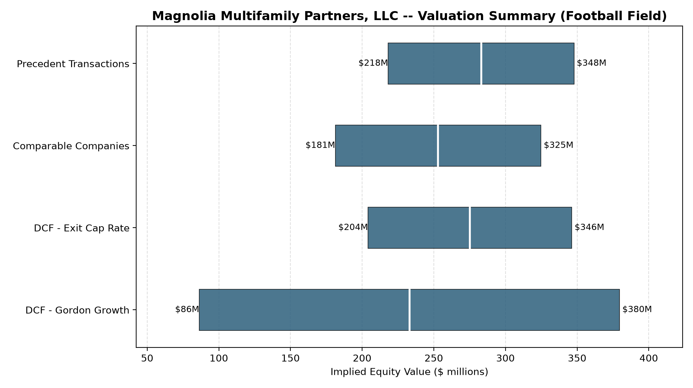

# Project Magnolia -- Sell-Side Advisory Deal Memorandum

**Prepared for:** Board of Directors, Magnolia Multifamily Partners, LLC
**Prepared by:** CenterCap Group (illustrative engagement)
**Date:** 2026-09-21

> **Illustrative data notice.** This memorandum is a portfolio/demonstration
> artifact built on synthetic company, portfolio, comparable-company, and
> transaction data. It is not investment advice and should not be relied
> upon for any actual transaction decision. See the project README for full
> methodology and data notes.

---

## 1. Situation Overview

CenterCap Group has been retained as exclusive sell-side financial advisor
to Magnolia Multifamily Partners, LLC ("the Company") to explore a full sale or majority
recapitalization. The Company owns and operates 12
garden-style and mid-rise multifamily communities totaling
3,060 units, concentrated in the Atlanta, GA metro
area. This memorandum summarizes the Company's financial profile, the
valuation work performed to date, and our recommended buyer/investor
outreach strategy.

## 2. Company Overview

- **Portfolio:** 12 properties, 3,060 units, built 2006-2019
- **Weighted average going-in cap rate:** 4.92%
- **Year 1 portfolio NOI:** $30,904,819
- **Year 5 portfolio NOI (projected):** $34,545,761
- **Consolidated net debt:** $315,000,000

Rent growth is assumed at 3.0% annually with occupancy
stabilizing toward 93% across the portfolio. Operating
expense growth is differentiated by line item, notably a
6.0% annual growth assumption for property insurance,
reflecting the well-documented run-up in Sun Belt multifamily insurance
costs in recent years.

## 3. Valuation Summary

Four methodologies were used to triangulate an implied equity valuation
range, summarized in the football field below.

| Methodology | Low | High | Midpoint |
|---|---|---|---|
| Precedent Transactions | $218M | $348M | $283M |
| Comparable Companies | $181M | $325M | $253M |
| DCF - Exit Cap Rate | $204M | $346M | $275M |
| DCF - Gordon Growth | $86M | $380M | $233M |

**Recommended valuation range: $218M - $325M
in implied equity value** (the band where all four methodologies overlap;
individual methodology ranges are wider, as shown above, with the DCF -
Gordon Growth method the most sensitive to its underlying assumptions).
Across all four methodologies, the average midpoint is approximately
$261M.

- **DCF (unlevered FCF discounted at a WACC of 7.80%):** run under both a
  Gordon Growth terminal value (2.50% long-term growth) and an
  exit-cap-rate terminal value (5.17% assumed exit cap rate), each
  sensitized across a range of discount rates and terminal assumptions.
- **Comparable public companies:** P/FFO, P/AFFO, and EV/EBITDA multiples
  from a set of publicly traded multifamily REITs, applied to the
  Company's projected Year 1 FFO, AFFO, and EBITDA.
- **Precedent transactions:** price-per-unit, cap-rate-paid, and EV/EBITDA
  multiples from a set of realistic recent multifamily M&A transactions,
  applied to the Company's unit count, forward NOI, and EBITDA.

## 4. Buyer / Investor Recommendation

Based on a structured screen of the strategic and
financial buyer universe -- scored on geographic and asset-class fit,
alignment with each buyer's stated investment thesis, and balance sheet
capacity relative to the implied deal size -- the following are our
top-ranked outreach targets:

| Rank | Buyer | Type | Score | Rationale |
|---|---|---|---|---|
| 1 | Cascade Residential Trust | Strategic | 5.0 | Public multifamily REIT with an existing Sun Belt garden/mid-rise portfolio, actively acquiring to densify Southeast markets. |
| 2 | Ridgemont Living | Strategic | 5.0 | Private regional multifamily operator based in the Southeast, actively rolling up garden-style communities via a programmatic acquisition vehicle. |
| 3 | Foundry Street Partners | Financial | 4.6 | Middle-market private equity real estate fund specializing in growth capital and recapitalizations for regional operating platforms. |
| 4 | Northgate Real Estate Capital | Financial | 4.6 | Value-add-focused private equity real estate fund, Sun Belt multifamily specialist, typically holds 4-6 years. |
| 5 | Bluepoint Residential Partners | Strategic | 4.5 | Public multifamily REIT, national footprint, opportunistic bolt-on M&A strategy, has done 2 portfolio acquisitions of similar size in the past 3 years. |

We recommend a targeted first-round outreach to the top five buyers above,
running strategic and financial buyers on a parallel process to maximize
competitive tension.

## 5. Next Steps

1. Finalize the confidential information memorandum (CIM) and data room.
2. Launch first-round outreach to the buyer list above.
3. Collect indications of interest and narrow to a second-round group.
4. Facilitate management presentations and property tours for finalists.
5. Solicit best-and-final offers and negotiate definitive documentation.
